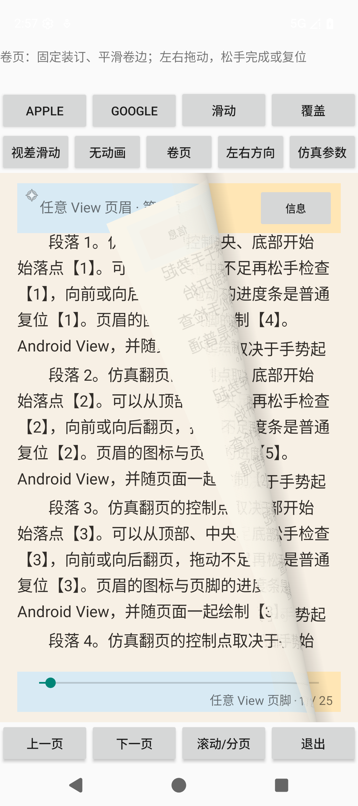

# Shader 翻页路线与独立预览

日期：2026-10-12。本文是当前卷页版本的设计与接入文档。目标是平滑卷页、固定装订、稳定文字映射和双向拖动结算。它是可控几何模型。此前专门的仿真研究文档、脚本和旧实验效果已从项目源码与文档目录移除。

## 2026-10-13：Web 阴影验收候选

### Android 当前实现与公开配置

用户已要求迁入Android。读取用户当前浏览器页面得到：进度0.275、卷曲宽度0.10、阴影强度0.25、柔和度0.43、倾斜0.55。后四项成为 `PageCurlOptions` 的默认值；观察进度仅记录，不冻结Widget动画。

```kotlin
reader.setPageTurnEffect(PageTurnEffects.pageCurl(PageCurlOptions(
    radiusFraction = 0.10f,
    shadowStrength = 0.25f,
    lightSize = 0.43f,
    tilt = 0.55f
)))
// 不可变配置也支持Java/Kotlin链式调整：
val options = PageCurlOptions().withShadowStrength(0.20f).withLightSize(0.50f)
reader.setPageTurnEffect(PageTurnEffects.pageCurl(options))
```

四个with函数及构造参数的公共注释说明作用、建议值与允许范围。自定义配置由宿主保存并重新传入；内置ID自动恢复只恢复默认配置，遵循库既有的可恢复工厂约定。

Android已替换为同一GLES2着色器生成整个翻页画面：逐像素反求材料UV，文字纹理采用三线性mipmap过滤（设备支持相应纹理能力时），正反面明暗与两种投影使用同一材料点和深度判定。移除Canvas窄带和独立阴影遮罩，避免卷边强压缩下的混叠及两层采样边界不一致。先上传两页快照到GPU，归还CPU快照租约，再从事务位图池租借输出；优先使用视口原尺寸，预算不足才逐级缩小。CPU位图预算不包含GL纹理、mipmap和读回缓冲区，当前完整帧读回需要进一步关注真机耗时。finish/abort/detach释放GL资源和输出租约，没有独立导航时钟。

Android统一在Web的材料坐标中计算，再转换纹理Y方向和最终读回方向；RTL同时转换几何输入和材料采样，前后翻交换GPU快照并使用相应纸面进度。Debug APK及Debug/Release AAR构建通过；已在API36查看[文字与阴影交接修正画面](generated/page-curl/android-text-shadow-fixed.png)。本轮没有运行自动测试，没有对API28或真机帧率作验收结论；本地Maven仓库未重新发布。

当前网页新增空间投影阴影及纸面方向光照，Android 已按用户要求迁入统一阴影，接入方式见本节。圆柱半径、装订和材料 UV 公式保持同一版本。

从接收面的空间位置沿光线向纸面求交：卷曲区求圆柱截面的二次方程，翻起的平面区求平面交点，再反求材料坐标并裁剪到实际页面矩形。使用48个固定面积光源样本，阴影偏移与软边范围随纸面高度变化，斜卷及纸张上下边界也参与投影。光线方向约为(-0.60,0.72,1)，纸面法向用于正反面漫反射，环境光保留纸面亮度。

根据用户截图进一步改进：将每条光线的二值遮挡改为连续覆盖率，在圆柱投影轮廓和有限纸张边界上使用连续过渡，各样本的柔化范围重叠，消除计数分级形成的条带。末端加入固定在屏幕像素上的亚色阶抖动，减轻8位显示色阶带，不随时间闪烁。这是对空间求交的有限宽度近似滤波，不是无限样本的精确面积光源积分。

`receiveShadow` 同时用于当前纸面和下一页：未掀起的当前纸面使用其平面高度，卷曲的正反面使用各自实际高度，下一页使用z=0。二者共用光源、投影强度、颜色和柔化参数；排除紧贴接收点的交点，避免将纸面自身接触点当成遮挡物。由高度差决定软边范围，不为当前页另画一条独立渐变。默认强度降为0.25，光源大小增为0.42；随后已按用户要求迁入 Android。

网页提供原版/新版对照、投影强度、光源大小和固定帧卷边倾斜控制；保留原有拖动、前后翻页及松手复位。平整端点直接绘制页面，消除残留阴影。48样本为验收候选质量参数，尚无手机性能结论，Android 已采用上节的GPU遮罩实现。

首版已在浏览器显示并切换同一35%进度、0.5倾斜的[原版画面](generated/page-curl/shadow-before.jpg)与[首版候选画面](generated/page-curl/shadow-candidate.jpg)，当时投影强度0.32、光源大小0.28。当前进一步调整的[统一阴影画面](generated/page-curl/shadow-unified.jpg)为36%进度、0.5倾斜，使用0.25强度和0.42光源大小；另外观察了用户截图对应的负倾斜方向。新版页面保持打开供验收；用户随后要求将此效果迁入 Android。

## 1. 已读取的直接参考

| 来源 | 已读内容 | 使用范围 |
| --- | --- | --- |
| Andrew Hung：[作者讲解](https://andrewhungblog.wordpress.com/2018/04/29/page-curl-shader-breakdown/) / [Shadertoy 原作](https://www.shadertoy.com/view/ls3cDB) | 作者博客的卷轴距离、圆柱反求 UV、两条材料分支 | 当前主要思路；Shadertoy 页面读取不稳定，未据其运行画面宣称复现 |
| GL Transitions：[InvertedPageCurl 编辑器](https://gl-transitions.com/editor/InvertedPageCurl) / [公开 GLSL](https://raw.githubusercontent.com/gl-transitions/gl-transitions/master/transitions/InvertedPageCurl.glsl) | 圆柱映射、背面、阴影、边缘处理；源码标注 HP、BSD-3-Clause | 对照卷曲显示；固定方向的图像过渡不能直接满足阅读器抓取和装订 |
| scriptituk：[SimplePageCurl GLSL](https://github.com/scriptituk/xfade-easing/blob/main/glsl/SimplePageCurl.glsl) | 圆柱半径、卷轴方向、进度、背面控制；注明改编 Hung | 对照参数结构；没有把改编文件的许可标注当作原始 Shadertoy 许可核验 |

预览的 GLSL 由本项目编写，没有直接复制以上着色器。第三方完整源码仅存放在忽略的研究构建目录。

## 2. 空间形状与装订

材料点 q=(u,v)，页面宽 W、高 1。单位向量 n 是卷轴在纸面内的法向，卷轴位置为 n·q=a，半径 r>0。令 s=n·q−a，轴脚 b=q−ns。未固定根部的空间位置为：

```text
s ≤ 0      : X=(q, 0)
0<s<πr     : X=(b+n r sin(s/r), r(1−cos(s/r)))
s ≥ πr     : X=(b+n(πr−s), 2r)
```

平面、圆柱、翻转平面按弧长连接，位置和切向连续。文字始终绑定材料坐标 q，不在屏幕坐标里单独拉伸。

前半程允许卷轴倾斜，但限制 a≥max(0,n.y)，使整个左侧装订仍处于平面段。倾斜在进度 0.35–0.62 平滑消退。后半程 n=(1,0)，所有截面减去左根点的空间位置，保持 X(0,v)=(0,v,0)。这条控制轨迹是本项目设定；并非手指施力的数值解。背面仅模拟浅色纸张与透印，尚无厚度与页叠模型。

半径随进度 p 变化：r=W·radiusFraction·(0.75+0.25 sin(πp))。水平轴时 a=(1−p)W−πrp；初始平整，结束纸张位于装订左侧，手机视口显示下一页。斜轴使用相应外缘最大投影，并执行上述装订限制。

## 3. 投影与文字反求

当前采用沿 z 轴的正交投影，不引入透视相机。屏幕点补回根部 x 位移后得到 original，d=n·original−a，轴脚 foot=original−nd。

```text
0≤d≤r：θ=asin(clamp(d/r,0,1))
        q_front=foot+n rθ
        q_back =foot+n r(π−θ)
d<0  ：q_tail=foot+n(πr−d)
```

逐一检查材料点是否在页面矩形内，按空间前后关系先显示卷曲背面，再显示正面或底页。UV=q/(W,1)。因此文字压缩、弯曲及背面镜像来自同一个空间映射。以圆柱法向调节亮度；底页阴影为解析近似，不是光线追踪。端点直接绘制完整当前页/目标页。

## 4. 当前交付与 Widget 接入边界

[WebGL2 预览](examples/shader-preview/index.html)包含五页，初始第2页。向左拖动进入下一页，向右拖动进入上一页；距离达到35%或速度超过每秒0.55页时提交，快速反向释放则复位。超过100ms的旧速度不用于释放判定。松手使用单调 Hermite 曲线，衔接同向释放速度并在端点停住，时长220–650ms。指针取消和拖动中失焦执行复位；动画中再次抓取从当前进度继续。页码仅在完成动画后提交一次，复位不修改页码，章首/章尾没有越界候选。进度条用于保持一个观察帧；上一页、下一页、复位按钮也走结算动画。

Widget接入：`reader.setPageTurnEffect(PageTurnEffects.pageCurl(options))`，稳定ID `page_curl`。`BoundPageCurlEffect`管理事务内快照上传和输出租约，`BoundPageCurlRenderer`管理GLES2上下文、纹理与完整帧输出，`BoundPageCurlShader`统一材料UV、正反面和阴影。背面透印仍为15%，不通过隐藏文字绕开采样问题。

效果复用 `SnapshotCurlEffect` 和快照预算，前翻使用当前页纸面，后翻使用候选页纸面并反转纸面进度，RTL 同时反射几何与纹理。进度、松手距离/速度策略、复位动画、资源租约及最终页码提交由现有 Widget 管理器和导航事务负责。默认 Widget 提交距离为33%、速度为600dp/s，由 `PageTurnOptions` 配置；网页的观察参数不覆盖 Widget 的输入设置。效果类没有独立时钟或导航控制器。Demo 菜单“卷页翻页”和效果列表“卷页”提供入口。

## 5. 构建与观察记录

`:app:assembleDebug` 和 `:app:ireadview:assembleDebug` 构建通过，产出 Demo APK 和 Widget Debug AAR。没有新增或运行自动测试套件。

| 平台 | 实际观察 | 范围 |
| --- | --- | --- |
| 本机 WebGL2 浏览器 | 左拖松手：2→3；右拖松手：3→2；20%处释放：仍为2并回到0% | 已看到结算中间进度和完成后状态 |
| emulator-5556 / API36 | LTR：1→2→1，短拖动仍为1；RTL：1→2→1 | 已检查斜卷边及页眉、正文、页脚的材料纹理；详见下图 |
| emulator-5558 / API28 | LTR：1→2→1，短拖动仍为1 | Activity切换和动画期间曾有UI树抓取失败；采用成功取得的新UI树确认终态，未使用旧树作为完成证据 |

首轮设备观察的Demo结算时长为1000ms；当前入口已调整为650ms，重新构建安装后，API36再次确认1→2→1及短拖动复位。未宣称真机帧率、所有页尺寸/内容/预算或用户视觉认可已通过。发布仓库原有Release产物未重新发布；本次新代码与Debug产物为当前实现。




